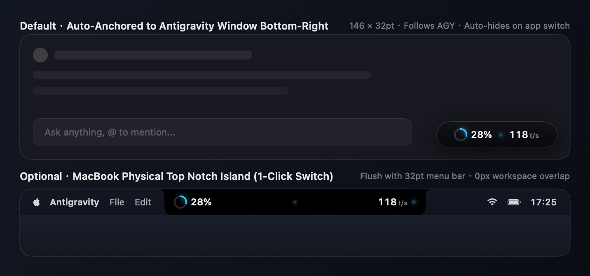
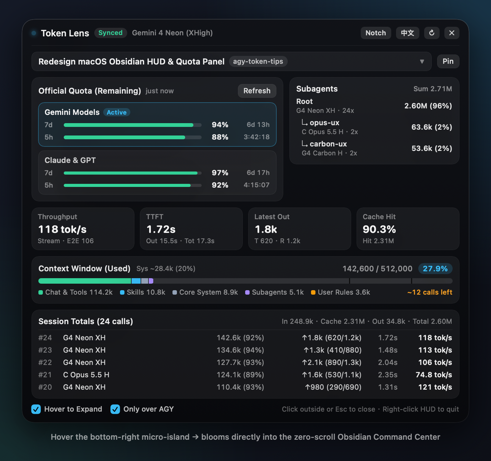

# agy-token-tips

[English](README.md) | [简体中文](README.zh-CN.md)

**See live speed, context fill, and your remaining 7-day / 5-hour quota right next to Antigravity Desktop** — no custom launcher, no background scripts, no client patching, and no restarting Antigravity.

**[Download for macOS Apple Silicon (`TokenLensHUD.app`, 440 KB)](https://github.com/arShen6/agy-token-tips/raw/refs/heads/main/downloads/TokenLensHUD-macos-arm64.zip)** · [All Releases](https://github.com/arShen6/agy-token-tips/releases)

---

## What it looks & feels like

When you're chatting in Antigravity, you normally can't tell how fast a model is streaming, whether your context is about to hit 90%, whether prompt caching broke, or **how much of your 7-day and 5-hour quota is left**.

**1. Out of your way while you work**
A tiny dark pill (`146 × 32pt`) quietly sticks to the **bottom-right corner of your Antigravity window** showing just two numbers: how full your context is (`28%`) and how fast the last reply streamed (`118 t/s`). Move or resize Antigravity and it follows automatically. Switch to Chrome or Slack and it disappears. Prefer zero window overlap? Right-click to dock it cleanly into your **MacBook's top physical notch**.



**2. Hover once to see everything (zero scrolling)**
Rest your cursor on the pill for a quarter second and the full dark panel opens right in place without stealing focus from your chat. One glance shows your **7-day and 5-hour remaining quota + live reset countdowns** (Gemini and Claude/GPT), streaming speed, TTFT, cache hit rate, what's actually eating your context window (Chat vs Skills vs Rules), Swarm subagents, and the last 5 calls. Move your cursor away and it tucks right back in.



> Want click-only instead of hover? Uncheck **Hover to Expand** at the bottom. Worried about quitting by accident? There's intentionally no Quit button inside the panel — right-click the pill (or the small gauge icon in your macOS menu bar) when you actually want to quit.

---

## How to download & use (Mac · Apple Silicon, macOS 14+)

1. **Download & unzip** [`TokenLensHUD-macos-arm64.zip`](https://github.com/arShen6/agy-token-tips/raw/refs/heads/main/downloads/TokenLensHUD-macos-arm64.zip), then drag **`TokenLensHUD.app`** into **Applications**.
2. **Open it once**: Because this is a free open-source build without paid Apple notarization, macOS will warn you the first time. Either **right-click → Open**, go to **System Settings → Privacy & Security → Open Anyway**, or run this one line in Terminal:
   ```bash
   xattr -cr /Applications/TokenLensHUD.app && open /Applications/TokenLensHUD.app
   ```
3. **That's it.** Keep using Antigravity normally — no need to restart it.

**A couple of handy tips:**
- **Seeing 7d / 5h official quota**: If you have the `agy` CLI installed and signed in (`~/.local/bin/agy` or Homebrew `agy`), the app fetches `/usage` quietly in the background (**0 turns, 0 tokens used**). If you don't have `agy` CLI installed, all live session metrics still work fine.
- **Adjust position**: Drag the small pill slightly up or left if you want it clear of any button — it remembers your custom offset relative to Antigravity's corner. Right-click → **Reset to AGY Bottom-Right** anytime.
- **Start at login**: Add `TokenLensHUD.app` under **System Settings → General → Login Items**.

### Prefer building locally? (No Gatekeeper warning)

```bash
git clone https://github.com/arShen6/agy-token-tips.git
cd agy-token-tips
bash macos-hud/build.sh
open macos-hud/dist/TokenLensHUD.app
```

---

## Why switch from the old version?

| | Old v0.2 (Composer Patch) | New v0.3 (`TokenLensHUD.app`) |
| --- | --- | --- |
| **Setup** | Install background service + always open AGY via custom launcher | Unzip & double-click — open AGY however you like |
| **Antigravity updates** | Can break when Electron UI changes | Standalone native Mac app, untouched by client updates |
| **7d / 5h Quota** | Not available | Built-in live 7d (top) & 5h (bottom) bars + countdowns |
| **Context & Swarm** | Text tooltip only | Visual context breakdown, runway estimate & subagent rollup |

---

## Windows / Linux (Experimental) & Legacy Composer Bar

Need Windows/Linux support, or still want the older composer-footer bar? Those packages are still here:

| Platform | Download | First-time setup | Launch Antigravity |
| --- | --- | --- | --- |
| Windows x64 | [English](https://github.com/arShen6/agy-token-tips/releases/download/v0.2.5/agy-token-tips-0.2.5-windows-x64-en.zip) · [Chinese](https://github.com/arShen6/agy-token-tips/releases/download/v0.2.5/agy-token-tips-0.2.5-windows-x64-zh-CN.zip) | Double-click `install.cmd` | Double-click `start-antigravity.cmd` |
| Linux x64 | [English](https://github.com/arShen6/agy-token-tips/releases/download/v0.2.5/agy-token-tips-0.2.5-linux-x64-en.zip) · [Chinese](https://github.com/arShen6/agy-token-tips/releases/download/v0.2.5/agy-token-tips-0.2.5-linux-x64-zh-CN.zip) | Run `bash install.sh` | Run `bash start-antigravity.sh` |
| macOS (Legacy) | [Mac Launcher](https://github.com/arShen6/agy-token-tips/raw/refs/heads/main/downloads/AGY-Token-Tips-macos-arm64.zip) · [EN](https://github.com/arShen6/agy-token-tips/releases/download/v0.2.5/agy-token-tips-0.2.5-macos-arm64-en.zip) · [ZH](https://github.com/arShen6/agy-token-tips/releases/download/v0.2.5/agy-token-tips-0.2.5-macos-arm64-zh-CN.zip) | Double-click `install.command` | Open `AGY-Token-Tips.app` |

<details>
<summary>How it works under the hood (privacy & local data)</summary>

- **Read-only local files**: Reads `~/.gemini/antigravity/conversations/<uuid>.db` and `conversation_summaries.db` in strict `SQLITE_OPEN_READONLY` mode and closes immediately (<2ms). Nothing is ever modified or uploaded.
- **No Accessibility permission needed**: Tracks Antigravity's window position via macOS's standard CoreGraphics window bounds API. Zero process injection.
- **Official quota check**: Runs `agy --output-format json -p /usage` asynchronously on demand and caches locally at `~/Library/Application Support/TokenLensHUD/quota-cache.json`.
- **Legacy source dev**: Requires Node.js >=22.16 (`npm test`, `npm run demo`). See [docs/protocol.md](docs/protocol.md).

</details>

---

Issues and PRs are always welcome ([CONTRIBUTING.md](CONTRIBUTING.md)). Inspired by [chuanban-antigravity-theme-patch](https://github.com/Anarcadia/chuanban-antigravity-theme-patch). [MIT License](LICENSE). Unofficial, not affiliated with Google.
