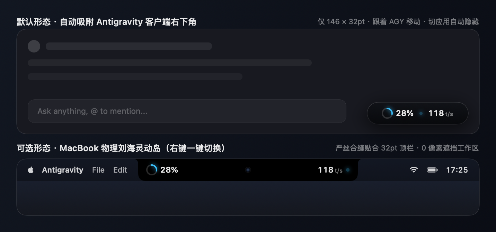
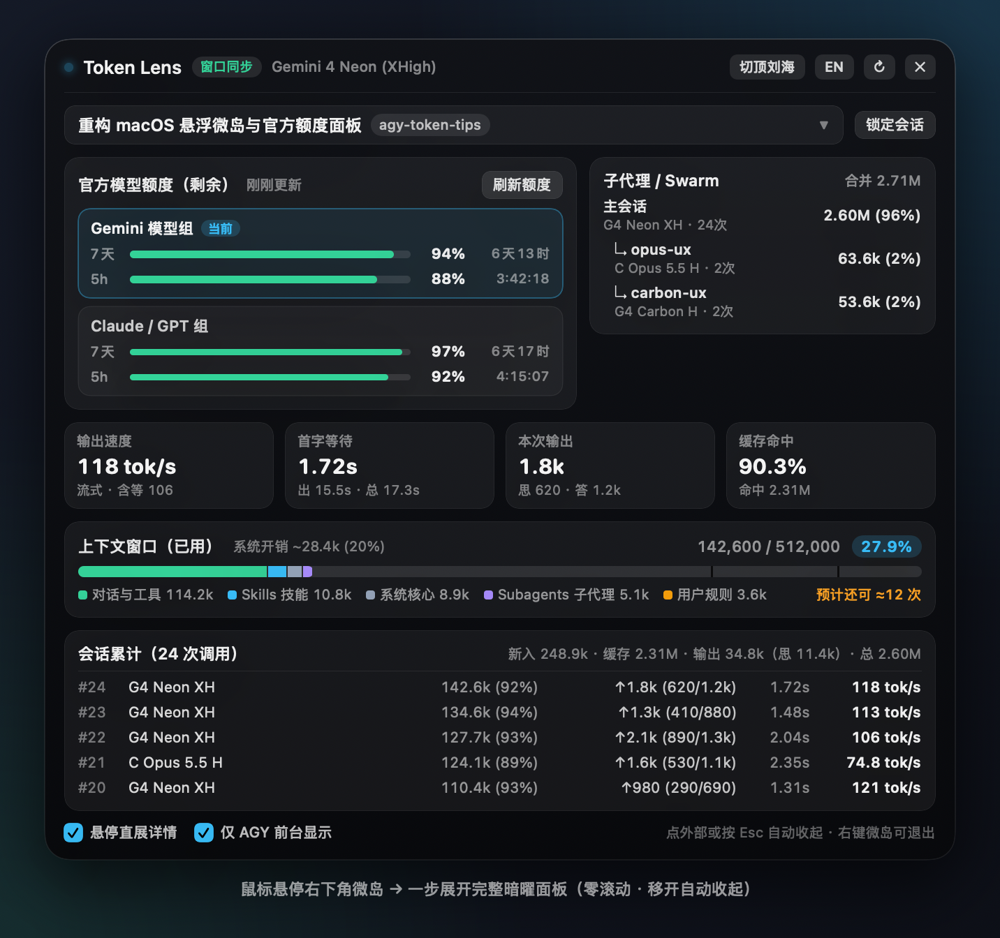

# agy-token-tips

[English](README.md) | [简体中文](README.zh-CN.md)

**在 Antigravity 桌面端随时看吐字速度、上下文占比和 7 天 / 5 小时剩余额度**——不用装后台服务、不用专用启动器、不改客户端、也不用重启 Antigravity，下载解压双击就能用。

**[直接下载 macOS 版（`TokenLensHUD.app`，仅 440 KB）](https://github.com/arShen6/agy-token-tips/raw/refs/heads/main/downloads/TokenLensHUD-macos-arm64.zip)** · [查看全部 Releases](https://github.com/arShen6/agy-token-tips/releases)

---

## 用起来是什么感觉？

平时用 Antigravity 写代码，客户端里看不到模型到底跑了多快、上下文是不是快满了、缓存有没有突然掉线，**更看不到自己 7 天和 5 小时的额度还剩多少**。

**1. 平时几乎不打扰你**
打开之后，只有一颗很小的黑曜石胶囊（`146 × 32pt`）贴在 **Antigravity 窗口右下角**，只留两个最关心的数：上下文用了多少（`28%`）、刚才吐字多快（`118 t/s`）。AGY 窗口拖到哪它就跟到哪，切去浏览器或微信就自动藏起来，完全不挡其他软件。如果你连右下角都不想占，右键一下就能切到 **MacBook 顶部的物理刘海** 里，0 像素遮挡聊天区。



**2. 鼠标放上去，一眼看清所有底细（不用上下滚屏）**
鼠标移到微岛上停顿约 0.24 秒，完整的暗色大面板直接原地展开，不抢你打字的焦点。一屏就能扫完：**Gemini 和 Claude/GPT 两组模型的 7 天（上）与 5 小时（下）剩余额度与实时倒计时**、首字等待时间、缓存命中率、上下文到底是被对话记录还是 Skills/规则占了、子代理一共花了多少、最近 5 次调用速度。鼠标移开自动收回去。



> 更习惯“点了再开”？把面板左下角的「悬停直展详情」勾掉就行。怕手滑把软件关了？面板里故意没放退出按钮，点外面或按 `Esc` 只是收起来；真想退出，**右键微岛**或者**右键顶部状态栏的小仪表盘**即可。

---

## 怎么下载和打开（M 系列 Mac，macOS 14 及以上）

1. **下载解压**：点这里下载 [`TokenLensHUD-macos-arm64.zip`](https://github.com/arShen6/agy-token-tips/raw/refs/heads/main/downloads/TokenLensHUD-macos-arm64.zip)，解压后把 **`TokenLensHUD.app`** 拖进「应用程序」。
2. **首次打开放行**：因为这是个人免费开源的小工具，没花钱买 Apple 公证，第一次打开系统可能会弹窗拦截。**右键点它选「打开」**（或在「系统设置 → 隐私与安全性」底部点「仍要打开」），或者嫌麻烦直接在终端贴这一行回车：
   ```bash
   xattr -cr /Applications/TokenLensHUD.app && open /Applications/TokenLensHUD.app
   ```
3. **好了，继续正常用 Antigravity 就行**，不需要重开客户端。

**几个顺手的小细节：**
- **怎么看 7 天 / 5 小时官方额度**：只要你电脑上装了并登录过 `agy` 命令行（`~/.local/bin/agy` 或 Homebrew 装的 `agy`），它会自动在后台调官方 `/usage` 查（**0 对话、0 Token 消耗**）；没装 `agy` 也不影响看速度、上下文和缓存。
- **位置觉得挡到按钮了？** 直接按住微岛往旁边拖一点，它会记住你相对 AGY 右下角的偏移量继续跟着走；右键随时能「重置到 AGY 右下角」。
- **想开机自动启动**：去「系统设置 → 通用 → 登录项与扩展」把 `TokenLensHUD.app` 加进去就行。

### 懂代码想自己编译？（完全不会触发系统拦截弹窗）

```bash
git clone https://github.com/arShen6/agy-token-tips.git
cd agy-token-tips
bash macos-hud/build.sh
open macos-hud/dist/TokenLensHUD.app
```

---

## 相比旧版好在哪？

| | 旧版 v0.2（输入框补丁） | 新版 v0.3（`TokenLensHUD.app`） |
| --- | --- | --- |
| **安装与启动** | 要装后台服务，每次必须点专用启动器重开 AGY | 解压双击就跑，Antigravity 照常随便开 |
| **抗更新能力** | AGY 升级界面结构后可能失效 | 独立原生 Mac 应用，跟客户端彻底解耦 |
| **7 天 / 5 小时额度** | 看不到 | 内置官方 7d（上）/ 5h（下）进度条与倒计时 |
| **上下文与子代理** | 只有纯文字浮层 | 分段看清谁占了上下文、还能聊几轮、Swarm 合并账单 |

---

## Windows / Linux（实验版）与旧版输入框方案

如果你在用 Windows / Linux，或者就喜欢旧版嵌在输入框旁的条子，原有安装包依然保留：

| 平台 | 下载安装包 | 首次安装 | 日常启动 Antigravity |
| --- | --- | --- | --- |
| Windows x64 | [中文版](https://github.com/arShen6/agy-token-tips/releases/download/v0.2.5/agy-token-tips-0.2.5-windows-x64-zh-CN.zip) · [英文版](https://github.com/arShen6/agy-token-tips/releases/download/v0.2.5/agy-token-tips-0.2.5-windows-x64-en.zip) | 双击 `install.cmd` | 双击 `start-antigravity.cmd` |
| Linux x64 | [中文版](https://github.com/arShen6/agy-token-tips/releases/download/v0.2.5/agy-token-tips-0.2.5-linux-x64-zh-CN.zip) · [英文版](https://github.com/arShen6/agy-token-tips/releases/download/v0.2.5/agy-token-tips-0.2.5-linux-x64-en.zip) | 运行 `bash install.sh` | 运行 `bash start-antigravity.sh` |
| macOS（旧版） | [Mac 启动器](https://github.com/arShen6/agy-token-tips/raw/refs/heads/main/downloads/AGY-Token-Tips-macos-arm64.zip) · [中文版](https://github.com/arShen6/agy-token-tips/releases/download/v0.2.5/agy-token-tips-0.2.5-macos-arm64-zh-CN.zip) · [英文版](https://github.com/arShen6/agy-token-tips/releases/download/v0.2.5/agy-token-tips-0.2.5-macos-arm64-en.zip) | 双击 `install.command` | 点 `AGY-Token-Tips.app` |

<details>
<summary>隐私与技术细节（给好奇怎么实现的同学）</summary>

- **只读本地记录，不上传任何数据**：以严格只读模式读取本机 `~/.gemini/antigravity/conversations/<uuid>.db` 和 `conversation_summaries.db`，读完立即关闭（<2ms），绝不改写你的聊天记录。
- **不索要辅助功能权限**：用 macOS 公开的 CoreGraphics 窗口坐标接口贴合 AGY 窗口，不注入进程、不修改 Antigravity 安装包。
- **官方额度来源**：后台按需调用本机 `agy --output-format json -p /usage`，本地缓存到 `~/Library/Application Support/TokenLensHUD/quota-cache.json`，不消耗 Token，不接触账号密码。
- **旧版 Node.js 源码开发**：需要 Node.js >=22.16（`npm test`、`npm run demo`），详见 [协议说明](docs/protocol.md)。

</details>

---

欢迎提 Issue 或 PR（见 [贡献指南](CONTRIBUTING.md)）。灵感来自 [船板的 Antigravity 补丁](https://github.com/Anarcadia/chuanban-antigravity-theme-patch)，独立实现，采用 [MIT 许可](LICENSE)，非 Google 官方项目。
